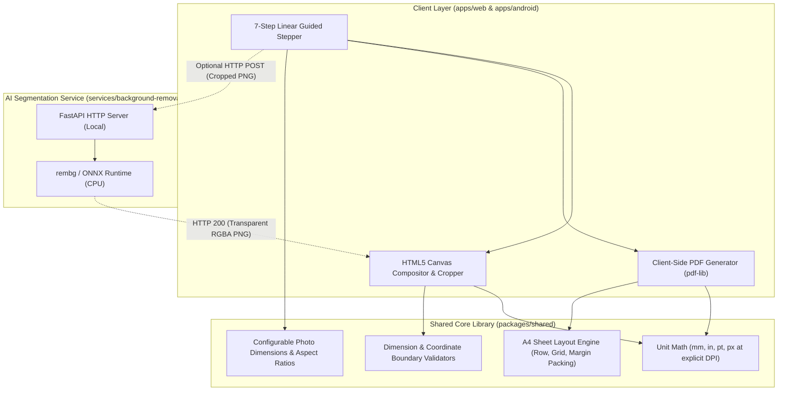
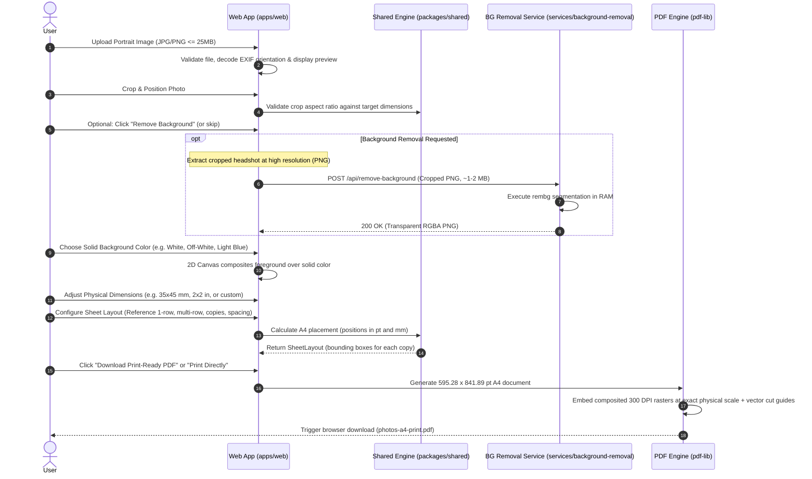

# Passport Photo Studio — Architecture Specification

**Version**: 1.1.0 (Revised for Practical Family Use)  
**Phase**: Phase 1A (Architecture Specification)  
**Status**: Ready for Review  
**Target Audience**: Developers, AI Implementation Agents, System Architects  

---

## 1. Executive Summary & Product Architecture

**Passport Photo Studio** is a focused, production-ready utility designed for a family member's everyday practical use: preparing, cropping, background-editing, and tiling small portrait photos for application forms, school/college submissions, and job forms onto an A4 sheet for physical printing.

### 1.1 Product Clarification: "Passport-Size Photo"
- The term **"passport-size photo"** is used informally to describe standard small portrait headshots used across daily documents, forms, and cards.
- **Out of Scope for Initial Release**: This is **NOT** a strict country-specific passport-compliance tool. Exhaustive international government databases, rigid biometric oval requirements, and automated face-geometry compliance rules have been removed from the initial scope to ensure simplicity and immediate utility.
- **Visual Reference Layout**: The provided visual reference (`passport size sample.pdf`) displays **six copies of the same portrait in one horizontal row near the top of an A4 portrait page**, with the remainder of the page left blank. The initial physical dimensions of the sample have not yet been measured; photo size is modeled as a configurable physical property ($W \times H$ in millimeters or inches) that will be measured or validated separately.
- **Workflow**:
  1. Upload a portrait image (JPG, JPEG, PNG).
  2. Crop and position the photo.
  3. Optionally remove the background using a local AI service.
  4. Choose a solid background color (e.g., white, off-white, light blue).
  5. Adjust the physical dimensions of the resulting photo.
  6. Arrange multiple copies on an A4 sheet (starting with the reference 1-row layout, with options for additional rows or custom copy counts).
  7. Preview the sheet and export a print-ready PDF or use the direct print workflow.



---

## 2. Monorepo Structure & Package Boundaries

The project uses an **npm workspaces monorepo** to maximize code reuse across Web and Android while isolating heavy machine learning dependencies.

```
passport-photo-studio/
├── apps/
│   ├── web/                         # React 18/19 + TypeScript + Vite + Tailwind CSS
│   │   ├── src/
│   │   │   ├── components/          # Reusable UI primitives (stepper, buttons, dialogs)
│   │   │   ├── features/
│   │   │   │   ├── upload/          # Drag-and-drop, EXIF normalization, validation
│   │   │   │   ├── crop/            # Interactive crop canvas, pan/zoom
│   │   │   │   ├── background/      # Optional segmentation client, color swatches
│   │   │   │   ├── dimensions/      # Physical size adjustment (mm / in)
│   │   │   │   ├── layout/          # Live A4 sheet canvas preview (sample row & grid)
│   │   │   │   └── export/          # 300 DPI PDF generation, direct print integration
│   │   │   ├── state/               # Ephemeral editor session state
│   │   │   └── main.tsx
│   │   ├── package.json
│   │   └── vite.config.ts
│   │
│   └── android/                     # React Native + Expo + TypeScript (Phase 7)
│       ├── src/
│       │   ├── screens/             # Step screens matching web workflow
│       │   └── native/              # Camera, PrintManager, ShareSheet bindings
│       └── package.json
│
├── packages/
│   └── shared/                      # Pure TypeScript business logic (Zero UI dependencies)
│       ├── src/
│       │   ├── units/               # Explicit conversions: mm, inches, pt (72 DPI), px (at DPI)
│       │   ├── dimensions/          # Configurable photo dimensions model & aspect ratios
│       │   ├── layout/              # A4 sheet layout: reference row, multi-row grid, cut guides
│       │   ├── validation/          # Dimensions, file size, aspect ratio boundary checks
│       │   └── index.ts
│       ├── tests/                   # Comprehensive unit tests for math and layout
│       ├── package.json
│       └── tsconfig.json
│
├── services/
│   └── background-removal/          # Python 3.11+ FastAPI microservice
│       ├── app/
│       │   ├── main.py              # FastAPI app, CORS, healthcheck, endpoints
│       │   ├── segmenter.py         # rembg ONNX session manager & inference pipeline
│       │   └── schemas.py           # Request/response validation
│       ├── requirements.txt         # fastapi, uvicorn, rembg[cpu], python-multipart
│       └── run.py                   # Local execution script
│
├── docs/                            # Architecture, roadmap, UI specifications, skill audit
├── package.json                     # Root monorepo workspace configuration
└── AGENTS.md                        # Root agent guidelines and standards
```

### 2.1 Package Responsibilities & Boundaries

| Package / Directory | Responsibilities | Forbidden Patterns |
| :--- | :--- | :--- |
| `packages/shared` | • Physical dimension math ($mm \leftrightarrow in \leftrightarrow pt \leftrightarrow px$ at explicit DPI).<br>• Configurable photo dimensions and aspect ratio calculations.<br>• A4 sheet layout engine (reference 1-row layout, grid packing, margin centering, cut guides).<br>• Boundary validation schemas (dimensions, coordinate ranges). | • **No DOM / Browser APIs** (`document`, `window`, `HTMLCanvasElement`).<br>• **No UI dependencies** (React, Tailwind).<br>• Must remain 100% testable in Node.js and reusable in React Native. |
| `apps/web` | • Interactive browser UI and 7-step guided workflow.<br>• Client-side image upload and EXIF rotation.<br>• 2D Canvas crop, zoom, and color compositing.<br>• Client-side 300 DPI PDF generation (`pdf-lib`).<br>• Native browser printing (`window.print()`). | • Must not execute heavy background removal locally in JavaScript.<br>• Must not persist photos in `localStorage` or `IndexedDB`. |
| `apps/android` | • Mobile touch gestures for photo cropping.<br>• Native device camera capture and photo gallery import.<br>• Native PDF export via Expo FileSystem and PrintManager. | • Must not duplicate geometry calculations (imports directly from `@passport-photo/shared`). |
| `services/background-removal` | • Exposes `POST /api/remove-background`.<br>• Loads ONNX segmentation model (`rembg`).<br>• Accepts binary image, returns transparent PNG.<br>• Manages memory buffers and enforces concurrency limits. | • Must not store uploaded images to permanent disk storage.<br>• Must not require database or authentication tokens. |

---

## 3. Image Editing & Data Flow



### 3.1 Non-Destructive Data Flow Principles

1. **Original Master File Retention**: The uploaded image is stored in memory as an immutable `File` / `Blob`. All operations (rotation, crop, compositing) produce lightweight coordinate parameters or offscreen buffers without altering the master.
2. **Crop Before Segmentation**: Sending only the cropped headshot to the background removal service drastically reduces payload size (~1–2 MB vs. 15 MB) and cuts CPU inference time to ~1.2s.
3. **Optional Background Removal**:
   - Background removal is an **optional step**, not a mandatory gate.
   - If the photo was taken against an acceptable plain wall or the user prefers the original background, they can skip directly to color adjustment or layout.
   - If the local Python service is offline, the user is alerted with a friendly message and allowed to continue seamlessly.
4. **Instant Color Swapping**: Because the transparent cutout is cached in memory, changing the background color performs an instant (< 16ms) 2D canvas composite without re-calling the AI service.
5. **Privacy & Ephemeral Memory**: Object URLs (`URL.createObjectURL`) are tracked and revoked upon file replacement or component unmount. The backend service processes in RAM using `io.BytesIO` and never writes images to disk.

---

## 4. Physical Dimensions, Units & Layout Geometry

### 4.1 Unit Definitions & Mathematical Rigor

Pixels have **no inherent physical size**—their physical dimensions depend entirely on output device resolution (DPI/PPI). All calculations in `@passport-photo/shared` treat physical measurements as authoritative and convert to digital representations using explicit DPI parameters:

$$\text{1 inch} = 25.4\text{ mm (exact international definition)}$$
$$\text{1 inch} = 72\text{ PostScript / PDF points (pt)}$$
$$\text{1 mm} = \frac{72}{25.4}\text{ pt} \approx 2.83464567\text{ pt}$$
$$\text{Pixels at specified DPI } d = \frac{\text{mm} \times d}{25.4}$$
$$\text{At 300 DPI: } 1\text{ mm} \approx 11.8110236\text{ pixels}$$

### 4.2 Configurable Photo Dimension Model

Rather than enforcing rigid international government presets, the application uses a flexible, configurable model:

```typescript
export interface PhotoDimensions {
  widthMm: number;
  heightMm: number;
  unitPreference: 'mm' | 'in';
}
```

- **Validation Rules**:
  - Minimum width / height: $15\text{ mm}$ ($0.6\text{ in}$).
  - Maximum width / height: $150\text{ mm}$ ($5.9\text{ in}$).
  - **Provisional Default Dimensions**: The exact physical dimensions of the reference sample have not been measured and remain unknown. No physical size (such as $35 \times 45\text{ mm}$ or $50.8 \times 50.8\text{ mm}$) is selected as the confirmed product default. The default photo size is kept strictly provisional and easily configurable in a single centralized module. Unit tests will rely on explicitly labeled test fixtures (`TEST_FIXTURE_PHOTO_SIZE`) rather than treating any size as a product default.
- **Aspect Ratio Locking**: When cropping, the crop bounding box aspect ratio ($W/H$) is strictly locked to `widthMm / heightMm`.

### 4.3 A4 Sheet Layout & Reference Layout

Standard A4 Paper is defined as:
- **Dimensions**: $210\text{ mm} \times 297\text{ mm}$ ($595.28\text{ pt} \times 841.89\text{ pt}$).

#### Configurable Single-Row Layout (Reference Sample Pattern):
- **Reference Pattern**: Inspired by `passport size sample.pdf` (which shows a single horizontal row of 6 copies near the top of the A4 page, leaving the rest of the sheet blank).
- **Configurable Copy Count**: The single-row arrangement is not restricted or hardcoded to six copies. The layout engine accepts an arbitrary copy count $N$, photo dimensions ($w, h$), top margin, and inter-photo spacing (gutter $g$).
- **Placement & Fit Detection**:
  - Usable page width: $W_{avail} = W_{sheet} - (m_{left\_min} + m_{right\_min})$.
  - Required width for $N$ copies: $W_{required} = N \cdot w + (N - 1)g$.
  - **Fit Validation**: If $W_{required} > W_{avail}$, the layout engine returns a clear validation result (`fits: false`, with error details and the maximum fitting count $N_{max} = \lfloor (W_{avail} + g) / (w + g) \rfloor$), preventing clipping or silent distortion.
  - **Centering**: When the row fits ($W_{required} \le W_{avail}$), the engine centers the copies symmetrically across the page:
    $$m_{left} = \frac{W_{sheet} - W_{required}}{2}$$
    $$x_i = m_{left} + i \cdot (w + g) \quad \text{for } i \in [0, N-1]$$
    $$y_i = m_{top}$$

#### Multi-Row Grid Tiling:
For arranging larger numbers of copies that exceed a single row (or when multi-row packing is explicitly chosen):
- **Usable Bounds**: $W_{avail} = W_{sheet} - 2 \cdot m_{side}$, $H_{avail} = H_{sheet} - 2 \cdot m_{top}$.
- **Grid Capacity**: Computes maximum columns $C = \lfloor (W_{avail} + g) / (w + g) \rfloor$ and rows $R = \lfloor (H_{avail} + g) / (h + g) \rfloor$.
- **Validation**: Detects if requested copies exceed single-page capacity and handles multi-page pagination or overflow reporting.
- **Cut-Guide Coordinates**: Pure mathematical coordinate calculation ($0.5\text{ pt}$ corner crosshairs outside the photo boundary) without rendering in Phase 1B.

---

## 5. Background Removal Service Architecture

### 5.1 Service Profile
- **Runtime**: Python 3.11+
- **Framework**: FastAPI + Uvicorn ASGI server
- **Model**: `rembg[cpu]` using ONNX Runtime. Default model: `u2net_human_seg` (~160 MB, trained for human portrait segmentation).
- **Inference Profile**: ~1.2 to 2.4 seconds on modern CPU for a cropped $800 \times 1000$ portrait. RAM usage: ~450 MB.
- **Boundary**: HTTP POST `/api/remove-background`.
  - Input: Multipart form image binary.
  - Output: 4-channel `image/png` (RGBA with alpha mask).
  - Memory: Fully ephemeral via `io.BytesIO()`. No images persisted to disk.
  - Concurrency: Restricted via semaphore to prevent memory exhaustion on resource-constrained host machines.

---

## 6. PDF Generation, Printing & The 100% Scale Reality

### 6.1 PDF Generation Engine (`pdf-lib`)
Generated client-side in pure TypeScript:
1. Creates an A4 document ($595.28 \times 841.89\text{ pt}$).
2. Embeds the composited photo as a high-density 300 DPI raster.
3. Positions each copy at its exact point coordinates $(x_{pt}, y_{pt}, w_{pt}, h_{pt})$.
4. Draws vector cutting guides.
5. Draws an exact **50 mm physical verification ruler** in the bottom margin.

### 6.2 The 100% Scale Reality: Why Software Alone Cannot Guarantee Print Scale
> [!IMPORTANT]
> **No PDF metadata, CSS `@page` rule, or JavaScript API can force a physical printer driver to disable scaling.**
> Most consumer printer drivers, OS print dialogs, and browser print dialogs default to **"Fit to Printable Area"** or **"Fit to Page"** to protect against hardware edge-feed clipping. This shrinks the document by 3% to 7%, altering physical photo dimensions.

#### Application Safeguards:
1. **Explicit Pre-Print Dialog**: The UI displays a high-contrast modal with visual screenshots instructing the user:
   *"Set Scale to 100% (or 'Actual Size'). Do NOT choose 'Fit to Page'."*
2. **Physical Calibration Ruler (Phase 5 Feature)**: When PDF export is implemented in Phase 5, each printed sheet will include an exact $50\text{ mm}$ printed calibration ruler. The calibration ruler serves as an aid to help users detect scaling errors after printing, but software alone cannot guarantee accurate printer behavior.
3. **Direct Print CSS (Phase 5 Feature)**: Uses `@media print { @page { size: A4 portrait; margin: 0; } }` with exact millimeter dimensions for browsers that support direct printing.

---

## 7. Key Technical Decisions & Trade-Off Matrix

| Decision Area | Chosen Approach | Alternative Considered | Rationale & Trade-Off |
| :--- | :--- | :--- | :--- |
| **Product Scope** | Configurable photo dimensions for everyday forms | Exhaustive international biometric passport database | Avoids unnecessary complexity, maintenance burden, and rigid compliance gates for a simple family utility. |
| **Reference Layout** | Configurable single-row layout (reference 6 copies) & multi-row grid | Strict fixed layout | Accommodates the reference sample while allowing flexible copy counts with fit validation. |
| **PDF Generation** | `pdf-lib` (pure JS, client-side, Phase 5) | `jspdf` / `html2canvas` | Eliminates DOM rasterization artifacts and guarantees point-accurate physical positioning. |
| **AI Location** | Local FastAPI microservice (Phase 4) | In-browser WebAssembly | Avoids downloading ~100MB model weights into the browser; runs reliably on CPU with optional skip fallback. |
| **Design Language** | Tailwind CSS + Semantic Tokens (`better-*` skills) | Generic UI framework (MUI / AntD) | Delivers a lightweight, focused desktop-utility aesthetic without enterprise dashboard bloat. |

---

## 8. Unresolved Decisions & Next Steps

1. **Default Physical Photo Dimensions**:
   - The sample PDF has not been physically measured, so its exact photo dimensions remain unknown.
   - *Resolution*: No physical size (such as $35 \times 45\text{ mm}$ or $50.8 \times 50.8\text{ mm}$) is selected as the confirmed product default. The initial photo size is kept strictly provisional and easily configurable in a single central module. Unit tests will use explicitly labeled test fixtures (`TEST_FIXTURE_PHOTO_SIZE`), not confirmed product defaults. When physical measurements of the sample are validated, the confirmed dimensions can be updated in that single location.
2. **Layered PSD Export**:
   - Formally deferred to Phase 8 as an optional enhancement.
