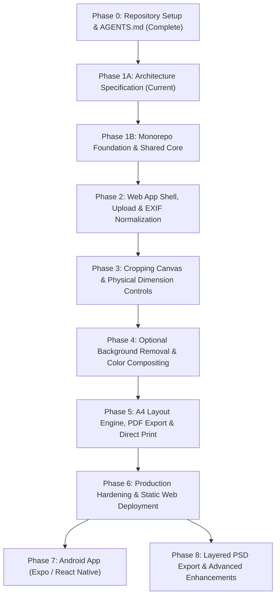

# Passport Photo Studio — Development Roadmap & Phased Execution Plan

**Version**: 1.1.0 (Revised for Practical Family Use)  
**Phase**: Phase 1A (Architecture Specification)  
**Status**: Ready for Review  
**Execution Policy**: All phases require explicit user confirmation before initiation.

---

## 1. Phase Overview & Dependency Graph



---

## 2. Detailed Phase Specifications

### Phase 0: Repository Setup & Instructions
- **Status**: **COMPLETE**
- **Deliverables**: Root `AGENTS.md` defining system architecture, engineering standards, UI rules, and execution policy.
- **Verification**: Verified file existence and alignment with project rules.

---

### Phase 1A: Architecture Specification (Current Phase)
- **Status**: **IN PROGRESS**
- **Goal**: Finalize revised architecture, package boundaries, data flows, API specifications, and phased implementation roadmaps reflecting the informal passport-size photo scope and reference sample layout.
- **Prerequisites**: Phase 0 complete.
- **Deliverables**:
  1. `docs/architecture.md`: Revised architecture, configurable photo dimension model, reference row layout, explicit unit math, and 100% scale print reality.
  2. `docs/development-roadmap.md`: Revised phased roadmap with updated deliverables and acceptance criteria.
  3. `docs/ui-specification.md`: Revised 7-step guided workflow, reference A4 preview, design tokens from `better-*` skills, and printing instructions.
  4. `docs/skill-audit.md`: Evaluation of all workspace skills in `.agents/skills/`, discovery status, and exclusion of foreign skills (`depthwizard`, `r3f-*`).
- **Acceptance Criteria**:
  - Documentation accurately reflects non-technical, family-oriented photo printing.
  - Complex international biometric compliance databases are completely removed from initial scope.
  - Clear reference to `passport size sample.pdf` (6-photo top row layout) as the initial visual reference.
- **Explicit Exclusions**:
  - No application code scaffolding or package installations.
  - No Git repository initialization.

---

### Phase 1B: Monorepo Foundation & Shared Core Package
- **Goal**: Establish the npm workspaces root and build the pure TypeScript `@passport-photo/shared` mathematical core library.
- **Prerequisites**: Phase 1A approved.
- **Deliverables**:
  - Root `package.json` configured with workspaces (`packages/*`, `apps/*`).
  - Root `.gitignore` for Node, Python, and Vite artifacts.
  - `packages/shared/package.json` with strict TypeScript configuration (`tsconfig.json`).
  - Physical measurement conversion utilities: $mm \leftrightarrow in \leftrightarrow pt \leftrightarrow px$ at an explicitly supplied DPI parameter.
  - Configurable physical photo dimensions and boundary validation ($15\text{ mm} \le W, H \le 150\text{ mm}$), with a provisional default configuration in a single central module (no confirmed product default selected yet).
  - A4 page geometry constants ($210 \times 297\text{ mm}$, $595.28 \times 841.89\text{ pt}$).
  - Configurable single-row photo placement engine:
    - Accepts an arbitrary copy count $N$ (with 6 copies being the reference example pattern from `passport size sample.pdf`).
    - Calculates exact positions from supplied photo dimensions, page margins, and inter-photo spacing.
    - Symmetrically centers the row when it fits within usable page width.
    - Validates fit and returns a clear error / overflow result if the requested row exceeds usable A4 width.
  - Multi-row grid layout engine: Computes column and row distributions for larger numbers of copies.
  - Cut-guide coordinate calculations: Pure mathematical coordinate offsets for corner ticks, strictly decoupled from rendering.
  - Comprehensive unit test suite covering conversion accuracy, invalid inputs, boundary conditions, spacing, copy counts, and layouts that do not fit, using explicitly labeled test fixtures (`TEST_FIXTURE_PHOTO_SIZE`).
- **Acceptance Criteria**:
  - All physical dimension calculations accurate to within $0.001\text{ mm}$ and $0.01\text{ pt}$.
  - Single-row layout engine correctly calculates symmetrical margins and reliably detects/reports overflow when copies exceed usable width.
  - Unit tests pass 100% using explicitly labeled test fixtures.
  - Shared package compiles cleanly with zero TypeScript errors under `strict: true`.
  - Zero UI, DOM, or print/PDF dependencies in `packages/shared`.
- **Verification Commands**:
  ```bash
  npm run build --workspace=@passport-photo/shared
  npm run test --workspace=@passport-photo/shared
  ```
- **Explicit Exclusions**:
  - No PDF generation, PDF drawing, or `pdf-lib` implementation.
  - No print dialogs, CSS `@media print` rules, or calibration-ruler rendering (deferred to Phase 5).
  - No React or Vite application code (deferred to Phase 2).
  - No background removal microservice setup (deferred to Phase 4).
  - No Android application code (deferred to Phase 7).
  - No country-specific passport databases or biometric face-geometry calculations.

---

### Phase 2: Web Application Shell, Upload & EXIF Normalization
- **Goal**: Scaffold the React + Vite web client and implement Step 1 (Upload, EXIF orientation correction, and image validation).
- **Prerequisites**: Phase 1B complete.
- **Deliverables**:
  - Scaffold `apps/web` with Vite, React 18/19, TypeScript, and Tailwind CSS.
  - Implement design tokens and styling rules based on discovered `better-ui`, `better-layout`, `better-colors`, and `better-typography` skills.
  - Clean, utility-oriented Application Shell (Header, 7-Step Stepper, Main Workspace, Footer).
  - Drag-and-drop file upload zone supporting JPG, JPEG, and PNG (up to 25 MB).
  - Automatic EXIF orientation normalization using HTML5 Canvas decoding.
  - Client-side validation: file type check, file size limit check, image dimension minimums (>= 300x300 px).
  - Object URL memory lifecycle manager (`URL.revokeObjectURL` on cleanup).
- **Acceptance Criteria**:
  - Portrait photos taken on mobile phones render upright automatically regardless of EXIF orientation tags.
  - Non-image files or oversized files produce clear, human-friendly error messages (applying `better-writing`).
  - Stepper advances to Step 2 once a photo is loaded.
- **Verification Commands**:
  ```bash
  npm run build --workspace=apps/web
  npm run lint --workspace=apps/web
  ```
- **Explicit Exclusions**:
  - No cropping or background removal yet.

---

### Phase 3: Interactive Cropping Canvas & Physical Dimension Controls
- **Goal**: Implement Step 2 (Crop and position) and Step 5 (Physical photo dimension adjustments).
- **Prerequisites**: Phase 2 complete.
- **Deliverables**:
  - Interactive 2D crop canvas with smooth drag handles and pan/zoom controls.
  - Aspect ratio constraint locked to the configured photo dimensions.
  - Physical dimension input panel ($W \times H$ in millimeters with optional inches toggle).
  - Quick-select buttons for common informal photo sizes (e.g., $35 \times 45\text{ mm}$, $50.8 \times 50.8\text{ mm}$ / $2 \times 2\text{ in}$, $50 \times 70\text{ mm}$).
  - Rotate ($90^\circ$ steps) and Reset Crop controls.
  - High-resolution crop slice extraction from master image for downstream processing.
- **Acceptance Criteria**:
  - Changing photo dimensions dynamically updates the crop aspect ratio.
  - Crop boundaries cannot be dragged outside image perimeter.
  - Cropped headshot extracted at high resolution without pixelation.
- **Verification Commands**:
  ```bash
  npm run test --workspace=@passport-photo/shared
  npm run build --workspace=apps/web
  ```
- **Explicit Exclusions**:
  - No biometric oval face overlays or government compliance checks.
  - No background removal inference yet.

---

### Phase 4: Optional Background Removal Service & Color Compositing
- **Goal**: Scaffold the local Python FastAPI microservice and implement Step 3 (Optional background removal) and Step 4 (Solid background color selection).
- **Prerequisites**: Phase 3 complete.
- **Deliverables**:
  - Scaffold `services/background-removal` (Python 3.11, FastAPI, Uvicorn, `rembg[cpu]`).
  - Endpoint `POST /api/remove-background` with ephemeral in-memory processing (`io.BytesIO`) and zero disk retention.
  - Startup script (`run.py`) and setup instructions (`requirements.txt`).
  - Step 3 & 4 Web UI:
    - "Remove Background" action button with progress spinner and cancel support.
    - **Optional Flow**: Clear "Skip / Keep Original Background" button.
    - Solid background color swatches: Pure White (`#FFFFFF`), Off-White (`#F8F9FA`), Light Blue (`#E6F0FA`), Light Grey (`#EDEDED`), and Custom Hex Picker.
    - Instant client-side 2D Canvas compositing of transparent RGBA foreground over the chosen color.
    - Offline fallback: If Python service is unreachable, display a friendly notice allowing the user to proceed with their original background.
- **Acceptance Criteria**:
  - Background removal completes in $< 2.5\text{ seconds}$ on standard CPU for cropped headshots.
  - Color swatches update the preview instantly (< 16ms) without re-invoking the AI service.
  - User can proceed without background removal if desired.
- **Verification Commands**:
  ```bash
  python -m pytest services/background-removal/tests
  npm run build --workspace=apps/web
  ```
- **Explicit Exclusions**:
  - No PDF generation yet.

---

### Phase 5: A4 Layout Engine, PDF Export & Direct Print
- **Goal**: Implement Step 6 (A4 Sheet Layout) and Step 7 (300 DPI PDF Export & Direct Printing).
- **Prerequisites**: Phase 4 complete.
- **Deliverables**:
  - Step 6 Interactive A4 Sheet Layout:
    - Real-time SVG/Canvas preview of an A4 sheet ($210 \times 297\text{ mm}$).
    - **Reference Layout Toggle**: 1 horizontal row of 6 photos near top margin (matching `passport size sample.pdf`).
    - **Grid Layout Mode**: Multiple rows for higher copy counts (e.g. 12, 16, or maximum fit).
    - Controls for copy count, top margin ($10\text{–}30\text{ mm}$), side margins, and inter-photo spacing ($3\text{–}10\text{ mm}$).
    - Toggle for cutting guidelines (corner crosshairs).
  - Step 7 Export & Print UI:
    - "Download Print-Ready PDF" button using `pdf-lib`.
    - Generates exact $595.28 \times 841.89\text{ pt}$ A4 PDF with 300 DPI embedded rasters.
    - Embeds a $50\text{ mm}$ physical calibration ruler in sheet margins for post-print validation.
    - "Print Directly" button triggering `@media print` browser printing.
    - High-contrast Printer Scale Warning Modal alerting users to choose **Scale: 100% / Actual Size**.
- **Acceptance Criteria**:
  - Generated PDF reports exact physical dimensions of $210 \times 297\text{ mm}$ in PDF viewers.
  - Individual photos on the generated sheet match configured physical dimensions within $\pm 0.2\text{ mm}$.
  - Reference 1-row layout correctly places 6 copies at the top, leaving the lower area blank.
- **Verification Commands**:
  ```bash
  npm run test --workspace=@passport-photo/shared
  npm run build --workspace=apps/web
  ```
- **Explicit Exclusions**:
  - No Android native app code.

---

### Phase 6: Production Hardening & Static Web Deployment
- **Goal**: Full end-to-end regression testing, accessibility audits, error boundaries, and static web production build.
- **Prerequisites**: Phase 5 complete.
- **Deliverables**:
  - Global React Error Boundary and recovery screens.
  - Comprehensive UI/UX audit using `better-interface` and `better-accessibility` (WCAG 2.1 AA compliance).
  - Mobile-responsive layout tuning for tablets and small screens.
  - Production build optimization (`npm run build`).
  - Deployment configuration for free static web hosting (GitHub Pages / Cloudflare Pages) and documented local backend launch guide.
- **Acceptance Criteria**:
  - All unit, integration, and geometry tests pass.
  - Production build generates clean static assets with zero TypeScript or linting warnings.
  - Complete end-to-end workflow verified on sample portrait files.
- **Verification Commands**:
  ```bash
  npm run lint
  npm run test
  npm run build
  ```

---

### Phase 7: Android Application (React Native / Expo)
- **Goal**: Mobile application scaffolding and touch-optimized photo preparation.
- **Prerequisites**: Phase 6 complete and approved.
- **Deliverables**:
  - Scaffold `apps/android` using Expo and TypeScript.
  - Connect to `@passport-photo/shared` for geometry and layout.
  - Native camera capture and photo gallery import.
  - Pinch-to-zoom and pan touch cropping.
  - Android PrintManager integration and system ShareSheet for PDF distribution.
- **Acceptance Criteria**:
  - Runs in Expo Go / Android virtual device.
  - Produces identical 300 DPI A4 PDFs matching the web output.
- **Verification Commands**:
  ```bash
  npm run test --workspace=apps/android
  ```

---

### Phase 8: Layered PSD Export & Advanced Enhancements
- **Goal**: Investigate and implement optional layered Photoshop (PSD) export for professional lab handoff.
- **Prerequisites**: Phase 7 complete.
- **Deliverables**:
  - Benchmark client-side `ag-psd` versus backend Python `pypsd` for creating multi-layer files (Background Color Layer + Cutout Subject Layer + Grid Layer).
  - Implement "Export Layered PSD" button if technically reliable.
- **Acceptance Criteria**:
  - Exported `.psd` file opens cleanly in Adobe Photoshop / GIMP with intact editable layers.
