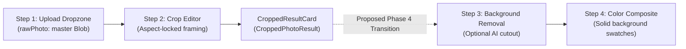

# Phase 4A: Pre-Implementation Audit — Optional Background Removal

**Date**: October 19, 2026  
**Status**: Ready for Project Owner Review  
**Author**: Antigravity AI Assistant  
**Repository**: `D:\Photo-print`

---

## 1. Executive Summary & Verified Repository State

This pre-implementation audit evaluates technical architectures for introducing **Step 3: Optional Background Removal** to Passport Photo Studio without compromising privacy, physical print accuracy, or user simplicity.

### 1.1 Verified Repository Facts
- **Workspaces & Codebase**:
  - The repository is organized as an `npm` workspaces monorepo containing:
    - `packages/shared`: Pure TypeScript geometry, physical dimension math ($mm \leftrightarrow in \leftrightarrow pt \leftrightarrow px$ at explicit DPI), and A4 layout engines (51 passing unit tests).
    - `apps/web`: React 19, TypeScript, Vite, and Tailwind CSS implementing Step 1 (Upload/EXIF) and Step 2 (Interactive Aspect-Locked Crop with 8 resize handles and URL lifecycle safety) (63 passing unit tests).
  - Production web bundle builds cleanly in $< 700\text{ms}$ with zero TypeScript errors under `strict: true`.
- **Backend / Python State**:
  - The `services/` directory does not currently exist.
  - The host machine has **Python 3.11.9** installed.
  - Existing Python environment inspection reveals pre-installed packages: `fastapi` (0.135.1), `uvicorn` (0.41.0), `torch` (2.14.0+cpu), `pillow` (12.1.1), `python-multipart` (0.0.22), and `numpy` (2.4.3).
  - `rembg` and `onnxruntime` are **not installed** in the global environment and must be managed via an isolated virtual environment (`services/background-removal/.venv`) to prevent system-wide package pollution.
- **Git State**:
  - Git repository remains uninitialized in compliance with project rules.

---

## 2. Current Architecture & Integration Points

### 2.1 Web Application Data Flow & Step Navigation


### 2.2 Precise Step 3 Integration Points
1. **Input Data**:
   - Step 2 produces a high-resolution `CroppedPhotoResult`:
     - `blob: Blob`: High-quality JPEG slice of the framed portrait (rendered at $\ge 300\text{ DPI}$ with a minimum 600px width floor).
     - `photoDimensions: PhotoDimensions`: Configurable physical measurements ($W \times H$ in mm).
     - `cropSettings: CropSettings`: Normalized zoom, pan, rotation, and active crop box coordinates.
   - Operating directly on the **cropped slice** (rather than the full 15–25 MB camera raw) reduces payload transfer to $\approx 500\text{ KB} - 1.5\text{ MB}$ and cuts inference latency by $\approx 70\%$.
2. **State & URL Management**:
   - `photoUrlTracker.ts` tracks active object URLs and safely coordinates cleanup.
   - Step 3 introduces a new derived asset: `cutoutPhoto: { blob: Blob; objectUrl: string } | null`.
   - If the user clicks **"Skip / Keep Original"**, `cutoutPhoto` remains `null`, and downstream steps consume the existing `croppedPhoto.blob`.
   - If background removal succeeds, `cutoutPhoto` stores the transparent RGBA PNG blob. Changing background colors in Step 4 composites this cutout over solid colors on an offscreen HTML5 canvas in $< 16\text{ms}$ without re-calling any AI model.
3. **Step Navigation**:
   - `Stepper.tsx` already lists Step 3 as `"Background"` (`3. Background`) and Step 4 as `"Color"` (`4. Color`).
   - `App.tsx` will advance from `currentStep = 2` to `currentStep = 3` upon confirming crop framing.

---

## 3. Evaluation of Background Removal Options

We evaluate three potential architectures against the product's requirements:

| Evaluation Dimension | Option A: Client-Side Browser (WASM / ONNX Web) | Option B: Local Python FastAPI Service (`rembg[cpu]`) | Option C: Remotely Hosted Cloud Inference Service |
| :--- | :--- | :--- | :--- |
| **Setup & Ongoing Cost** | **$0.00**. No servers, no APIs, no recurring costs. | **$0.00**. Completely free, open-source local CPU inference. | **Ongoing cost**. Requires cloud hosting ($5–$25/mo VM) or third-party commercial API ($0.01–$0.05/image). |
| **Photo Privacy** | **100% On-Device**. Photos never leave browser memory. | **100% On-Device**. Sent only to local loopback (`127.0.0.1:8000`). | **Photos leave device**. User photos are transmitted over the Internet to third-party servers. |
| **Memory & Compute Footprint** | Downloads 40–175 MB model into browser cache on first run. Requires 500 MB–1.5 GB browser RAM. May crash mobile/low-spec browser tabs. | Runs in dedicated Python OS process (~350–500 MB RAM). Uses optimized C++ ONNX CPU SIMD threads. | Zero client compute burden; lightweight HTTP fetch only. |
| **Execution Latency (Cropped Headshot)** | ~3.0s – 8.0s on CPU WASM; ~1.5s with WebGPU (if hardware acceleration available). | **~0.8s – 1.8s** on modern standard desktop multi-core CPU. | ~1.5s – 3.0s (network roundtrip dependent). |
| **Installation & Maintenance Complexity** | **Zero backend setup**. Runs directly in static web bundle. Minor Vite build configuration for wasm assets. | Requires Python 3.11, virtual environment, and starting a local service (`python run.py`). Two processes to run concurrently. | Requires cloud deployment, SSL certificates, API keys, rate-limiting, and billing management. |
| **Beginner / Non-Technical Maintainer** | **High**. Single TypeScript/React codebase. No multi-language toolchain to synchronize. | **Moderate**. Requires understanding Python virtual environments and local port handling. | **Low**. High operational maintenance, security attack surface, and billing oversight. |
| **Compatibility with Crop Workflow** | Seamless: accepts cropped `Blob`, returns transparent `Blob`. | Seamless: accepts cropped `Blob` via `multipart/form-data`, returns transparent PNG. | Compatible, but introduces network timeout risks and offline breakage. |

---

## 4. Recommended Architecture & Trade-Off Analysis

### 4.1 Recommendation: Option B (Local FastAPI Service) with Option A Prepared as Standalone Fallback
We recommend adhering to the project's established architectural roadmap: **Option B (Local Python FastAPI Service with `rembg[cpu]`)** as the primary engine for local development and desktop execution, with explicit graceful degradation:

1. **Why Local Python FastAPI (`rembg[cpu]`) Best Fits the Current Phase**:
   - **Privacy Compliance**: Guarantees zero photo transmission over the Internet, fulfilling Section 1.3 of `AGENTS.md`.
   - **Inference Stability & Quality**: `rembg` using `u2netp` or `birefnet-general` delivers professional portrait matting around fine hair strands with predictable CPU performance without causing browser tab memory exhaustion.
   - **Decoupled Architecture**: Keeps the heavy ML runtime completely isolated from the lightweight React/Vite front-end.
2. **Mandatory Graceful Degradation (Offline Mode)**:
   - The Python service must **never** be a hard blocker.
   - If the Python microservice is not running, the web UI automatically detects the offline state via a lightweight healthcheck (`GET /api/health`), displays a gentle notice:
     > *"Local background removal service is offline. You can proceed with your original background, or launch the service in your terminal (`python run.py`)."*
   - The user can click **"Skip / Keep Original"** and immediately proceed to Step 4 and Step 5.
3. **Future Extension (Browser-Side Static Deployment)**:
   - For Phase 6 (Static Web Deployment without a local Python daemon), a pure browser-side worker (e.g. `@imgly/background-removal` or `@xenova/transformers`) can be added as an in-browser fallback engine behind the same client interface.

---

## 5. Proposed API Specification & Service Contract

### 5.1 Service Directory Layout
```
services/background-removal/
├── .venv/                      # Isolated virtual environment (ignored in .gitignore)
├── app/
│   ├── __init__.py
│   ├── main.py                 # FastAPI application, CORS middleware, route handlers
│   ├── segmenter.py            # rembg Session cache, in-memory inference pipeline
│   └── schemas.py              # Health and error response schemas
├── tests/
│   └── test_api.py             # pytest test suite for healthcheck and segmentation
├── requirements.txt            # Minimal pinned dependencies
└── run.py                      # Local startup launcher (Uvicorn on port 8000)
```

### 5.2 Dependencies (`requirements.txt`)
```text
fastapi>=0.115.0
uvicorn[standard]>=0.30.0
python-multipart>=0.0.12
rembg[cpu]>=2.0.59
pillow>=10.4.0
pytest>=8.0.0
httpx>=0.27.0
```

### 5.3 Endpoint Specifications

#### 1. Healthcheck Endpoint
- **URL**: `GET /api/health`
- **Response**: `200 OK`
```json
{
  "status": "healthy",
  "service": "passport-photo-background-removal",
  "model": "u2netp",
  "device": "cpu"
}
```

#### 2. Segmentation Endpoint
- **URL**: `POST /api/remove-background`
- **Content-Type**: `multipart/form-data`
- **Request Body**:
  - `file`: Binary image file (`image/jpeg` or `image/png`, maximum $25\text{ MB}$).
- **Response**:
  - `200 OK`: Binary image data (`Content-Type: image/png`, `Cache-Control: no-store`) containing the RGBA portrait with a transparent background.
- **Error Responses**:
  - `400 Bad Request`: `{"error": "Unsupported file format. Please upload JPEG or PNG."}`
  - `413 Payload Too Large`: `{"error": "File size exceeds 25 MB limit."}`
  - `500 Internal Server Error`: `{"error": "Background segmentation failed during processing."}`

### 5.4 Privacy & Memory Invariants
- Images are decoded and processed strictly in RAM (`io.BytesIO`).
- No images, thumbnails, or temp files are ever written to the local hard drive.
- Model session (`rembg.new_session("u2netp")`) is initialized once at server startup and reused across requests.

---

## 6. Implementation Plan for Phase 4

Phase 4 will be divided into two manageable, independently verifiable sub-phases:

### Sub-Phase 4B: Backend Microservice (`services/background-removal`)
1. Create directory structure `services/background-removal/app/`.
2. Configure isolated Python virtual environment and pin `requirements.txt`.
3. Implement `app/segmenter.py` using in-memory `io.BytesIO` and `rembg`.
4. Implement `app/main.py` with CORS for `localhost:5173` and error handling.
5. Implement `run.py` launcher on `http://127.0.0.1:8000`.
6. Write unit and integration tests in `tests/test_api.py` covering healthcheck, valid image segmentation, oversized files, and invalid formats.
7. Verify with `pytest`.

### Sub-Phase 4C: Web Client Integration (Step 3 & Step 4)
1. Implement `apps/web/src/utils/backgroundRemovalClient.ts` to query `GET /api/health` and call `POST /api/remove-background`.
2. Build `apps/web/src/components/BackgroundRemovalView.tsx` (Step 3):
   - Preview of the cropped portrait.
   - Live backend connection badge (`Online` / `Offline`).
   - "Remove Background" CTA with accessible progress spinner.
   - Prominent "Skip / Keep Original Background" secondary button.
   - Actionable error alert with retry button if inference fails.
3. Build `apps/web/src/components/ColorCompositeView.tsx` (Step 4):
   - Solid color swatches: Pure White (`#FFFFFF`), Off-White (`#F8F9FA`), Light Blue (`#E6F0FA`), Light Gray (`#EDEDED`), and Custom Hex Picker.
   - Instant client-side 2D canvas compositing.
4. Wire navigation in `App.tsx` and verify object URL lifecycle for cutouts.
5. Verify build, typecheck, and unit test suites.

---

## 7. Explicit Acceptance Criteria for Phase 4

1. **Local Privacy**: No image data leaves the user's local machine; the Python service stores zero files on disk.
2. **Speed**: Background removal on a cropped portrait completes in $< 2.5\text{ seconds}$ on standard CPU.
3. **Optionality**: Users can bypass background removal with a single click on "Skip / Keep Original Background" and proceed immediately to color selection or layout.
4. **Resilience**: If the Python service is offline or fails, the user is never stuck; the app provides a friendly explanation and allows them to proceed with the original photo.
5. **No Regressions**: Existing photo upload, EXIF normalization, aspect-locked cropping, and object URL cleanup continue to pass all tests.

---

## 8. Risks and Decisions Requiring Project Owner Approval

Before any code is written for Phase 4B or 4C, the project owner should review and confirm:

1. **Approval of Architecture**:
   - Confirm approval of **Option B (Local Python FastAPI microservice with `rembg[cpu]`)** as the primary engine.
2. **Model Selection**:
   - We recommend `u2netp` (lightweight, ~4.7 MB model weights, $< 1\text{s}$ CPU inference) as the default model, rather than full `u2net` (~170 MB model weights, ~3–4s inference). Confirm this preference.
3. **Execution Scope**:
   - Confirm that implementation should proceed to **Phase 4B: Backend Microservice** first before front-end Step 3/4 integration.
