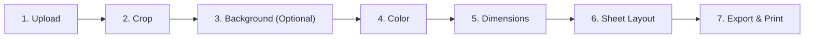

# Passport Photo Studio — UI/UX Specification & Design System

**Version**: 1.1.0 (Revised for Practical Family Use)  
**Phase**: Phase 1A (Architecture Specification)  
**Status**: Ready for Review  
**Design Philosophy**: Simple, intuitive, and reassuring photo preparation utility for everyday document printing. Focused desktop utility aesthetic (similar to macOS Preview), free of enterprise dashboard bloat.

---

## 1. Primary User Journey & Screen Architecture

The workflow is structured as a **7-step guided stepper** where each step has a single clear purpose, plain-language instructions, and exactly **one primary call-to-action**.



### 1.1 Step-by-Step Experience

| Step | User Goal | Workspace Canvas View | Control Panel / Actions |
| :--- | :--- | :--- | :--- |
| **1. Upload** | Import a portrait photo. | Large drag-and-drop zone with helpful guidelines. | "Choose Photo" button, format notes (JPG, PNG $\le 25\text{MB}$), friendly validation alerts. |
| **2. Crop & Position** | Frame the face cleanly. | Interactive 2D crop box with pan, zoom, and rotate handles. | "Rotate 90°", "Reset Crop", locked aspect ratio, "Next: Background →". |
| **3. Background (Optional)** | Isolate subject from distracting background. | Side-by-side or before/after preview. | "Remove Background with AI" (Primary), "Keep Original Background (Skip)" (Secondary). |
| **4. Color** | Select a clean solid background. | Live composite preview of subject against solid color. | Solid swatches: Pure White, Off-White, Light Blue, Light Grey, Custom Hex Picker. |
| **5. Dimensions** | Set the physical print size. | Live preview with overlaid physical dimension tags ($mm$ / $in$). | Width and Height inputs ($mm$ / $in$), provisional default configuration, quick size buttons. |
| **6. Sheet Layout** | Arrange copies onto an A4 page. | Scaled live A4 sheet preview ($210 \times 297\text{ mm}$) with arranged copies. | Configurable Single-Row Layout (reference 6 copies at top, adjustable count with fit detection), Multi-row grid selector, spacing controls, cut lines toggle. |
| **7. Export & Print** | Download print PDF or print directly. | Final high-resolution sheet preview with calibration ruler. | "Download Print-Ready PDF" (Primary), "Print Directly" (Secondary), **Printer Scale 100% Warning Modal**. |

---

## 2. Design Tokens & Visual Standards (`better-*` Skills)

The UI applies disciplined token standards discovered in `.agents/skills/`:

### 2.1 Color Tokens (`better-colors`)

| Token Name | Hex Value | Role & Usage |
| :--- | :--- | :--- |
| `surface-bg` | `#f8fafc` (`slate-50`) | Main application canvas background. |
| `surface-card` | `#ffffff` (`white`) | Workspace containers, control panels, and preview cards. |
| `surface-subtle` | `#f1f5f9` (`slate-100`) | Inactive stepper tabs, secondary button backgrounds. |
| `border-default` | `#e2e8f0` (`slate-200`) | Card borders, structural dividers. |
| `border-strong` | `#cbd5e1` (`slate-300`) | Input fields and active drag handles. |
| `text-primary` | `#0f172a` (`slate-900`) | Primary headers, labels, and active values. |
| `text-secondary` | `#475569` (`slate-600`) | Helper text, physical unit explanations. |
| `text-muted` | `#94a3b8` (`slate-400`) | Inactive tabs, placeholder text. |
| `brand-primary` | `#2563eb` (`blue-600`) | Primary action buttons and active step indicators. |
| `brand-hover` | `#1d4ed8` (`blue-700`) | Primary button hover state. |
| `status-success` | `#16a34a` (`green-600`) | Completed checks, validation confirmations. |
| `status-warning` | `#d97706` (`amber-600`) | Printer scaling alerts, margin notices. |
| `status-error` | `#dc2626` (`red-600`) | File type errors, connection timeout warnings. |

### 2.2 Typography Scale (`better-typography`)

- **Font Family**: Clean system font stack (`Inter`, system-ui, `-apple-system`, BlinkMacSystemFont, "Segoe UI", Roboto, sans-serif).
- **Tabular Numbers**: Physical dimensions ($mm$ and $in$) use `font-mono` or `font-feature-settings: "tnum"` to prevent layout jitter during adjustments.
- **Rule**: Never use micro-text below $12\text{px}$ (`text-xs`).

| Level | Size / Line Height | Tailwind Class | Usage |
| :--- | :--- | :--- | :--- |
| **App Title** | $28\text{px} / 36\text{px}$ | `text-2xl font-bold` | Header title. |
| **Section Title** | $20\text{px} / 28\text{px}$ | `text-lg font-semibold` | Step panel titles, modal headings. |
| **Field Label** | $16\text{px} / 24\text{px}$ | `text-base font-medium` | Dimension inputs, copy count labels. |
| **Body Regular** | $14\text{px} / 20\text{px}$ | `text-sm font-normal` | Explanations, helper guidance. |
| **Caption / Badge** | $12\text{px} / 16\text{px}$ | `text-xs font-semibold` | Step numbers, unit badges ($mm$, $in$). |

### 2.3 Layout & Spacing (`better-layout` & `better-ui`)

- **8px Modular Grid**: Margins and paddings use consistent multiples of 8px (`p-2`, `p-4`, `p-6`, `gap-4`, `gap-6`).
- **Concentric Border Radius**: Enforce $R_{outer} = R_{inner} + \text{padding}$ so nested containers feel optically cohesive.
- **Touch & Click Targets**: Minimum $44 \times 44\text{px}$ on desktop, $48 \times 48\text{px}$ on mobile/touch interfaces.
- **Subtle Elevation**: Use layered transparent box-shadows for elevation and keep sharp borders for structural boundaries.

---

## 3. Screen Structure & Layout Shell

On desktop and tablet viewports, the application provides a balanced **two-pane utility layout**:

```
+-------------------------------------------------------------------------------+
|  Passport Photo Studio          [1. Upload] > [2. Crop] > [3. Background]...  |
+-------------------------------------------------------------------------------+
|                                      |                                        |
|                                      |   STEP 6: A4 SHEET LAYOUT              |
|                                      |                                        |
|         WORKSPACE CANVAS             |   Layout Arrangement:                  |
|                                      |   (o) Single Row (6 copies at top)     |
|   (Interactive Live Preview:         |   ( ) Multi-Row Grid                   |
|    - High-Res Crop Area              |                                        |
|    - Color Composite                 |   Number of Copies:  [ - ]  6  [ + ]   |
|    - Full A4 Sheet with 6 copies     |                                        |
|      in top horizontal row)          |   Spacing between photos: 4 mm         |
|                                      |   Top margin: 15 mm                    |
|                                      |                                        |
|                                      |   [x] Show cutting guide marks         |
|                                      |   ----------------------------------   |
|                                      |   [ PRIMARY: NEXT: EXPORT & PRINT -> ] |
|                                      |   [ <- Back to Dimensions ]            |
+-------------------------------------------------------------------------------+
|  Privacy: 100% Local Processing      Paper: A4 (210 x 297 mm)     Scale: 100% |
+-------------------------------------------------------------------------------+
```

### 3.1 Mobile / Responsive Adaptation
- On viewports $< 768\text{px}$, the two panes stack vertically:
  - Top: Fixed-height scroll-locked canvas viewport showing the active preview.
  - Bottom: Scrollable step controls with large touch-friendly inputs.
  - Sticky bottom action bar for the primary step button.

---

## 4. A4 Sheet Layout Controls & Reference Pattern

The visual reference (`passport size sample.pdf`) illustrates **six copies of the portrait in one horizontal row near the top of an A4 page**:

1. **Configurable Single-Row Layout Mode (Sample Reference Pattern)**:
   - Inspired by `passport size sample.pdf`, which arranges copies horizontally across the upper margin of an A4 portrait sheet, leaving the lower portion blank.
   - **Configurable Copy Count**: The single-row arrangement is not fixed to six copies. The user can adjust the number of copies, top margin, and inter-photo spacing.
   - **Fit Detection & Guidance**: If the requested copy count or photo width exceeds the usable A4 width, the interface immediately displays friendly feedback (e.g., *"Only 4 copies of this size fit across a single row. Reduce copies or switch to Grid Layout."*).
   - Symmetrically centers the row horizontally when it fits.
   - Includes subtle vector corner tick cutting marks.
2. **"Grid Layout" Mode**:
   - For users needing more copies (e.g. 12, 16, or maximum sheet capacity).
   - Automatically computes optimal rows and columns based on the configured photo dimensions.
3. **Physical Dimension Controls (Familiar Units)**:
   - **Provisional Default Sizing**: Because the sample PDF has not been physically measured, its exact dimensions remain unknown and no confirmed product default is established yet.
   - Dimensions are easy to configure in one central location.
   - Width and Height inputs clearly marked in millimeters ($mm$) with an optional inches toggle ($in$).
   - Quick-select buttons for common small portrait photo sizes ($35 \times 45\text{ mm}$, $50.8 \times 50.8\text{ mm}$ / $2 \times 2\text{ in}$, etc.) for user convenience.
   - Live visual dimension tags directly on the preview so the user can verify physical sizing before printing.

---

## 5. Printing Guidance & Scale Warnings

Because software cannot override printer driver settings, the interface provides comprehensive, unambiguous printing guidance:

### 5.1 Pre-Print Instruction Modal
When clicking "Download Print-Ready PDF" or "Print Directly", a high-contrast modal appears:
```
+-----------------------------------------------------------------------+
|  ⚠️ IMPORTANT PRINTER SETTING (To Avoid Wrong Photo Sizes)            |
+-----------------------------------------------------------------------+
|  When your printer window opens, make sure to check this setting:    |
|                                                                       |
|  [✓] Set Scale to 100%  (or "Actual Size")                           |
|  [x] DO NOT select "Fit to Page" or "Shrink to Printable Area"       |
|                                                                       |
|  "Fit to Page" shrinks the document by 5%, making the photos smaller  |
|  than your requested physical dimensions.                             |
|                                                                       |
|  We have included a 50 mm verification ruler at the bottom of the     |
|  printed sheet. Check it with a real ruler to be 100% sure!           |
|                                                                       |
|                     [ Understood, Download PDF ]                      |
+-----------------------------------------------------------------------+
```

### 5.2 Physical Calibration Verification Ruler (Phase 5 Feature)
When PDF generation is implemented in Phase 5, the printed sheet will feature a fine $50\text{ mm}$ calibration ruler in the margin:
`"|---|---|---|---|---| 50 mm Ruler: Measure with a ruler to verify 100% scale"`
*Note*: This calibration ruler is an aid to help users detect scaling errors after printing; software cannot guarantee printer accuracy on its own.

---

## 6. Interaction States & Recovery

Every step accounts for all five interaction states:
- **Empty State**: Friendly invitation to drop an image, supported formats, and helpful photo tips ("Good lighting, facing front").
- **Processing State**: Spinner with clear status ("Removing background with AI...", "Building 300 DPI PDF...") with cancel button.
- **Success State**: Immediate crisp visual update on canvas with green status confirmation.
- **Error State**: Friendly, non-technical recovery messages (e.g., *"Photo is 30 MB. Please upload a photo under 25 MB."* or *"Background removal service is offline. You can proceed with your original photo background."*).
- **Completed State**: High-fidelity final A4 sheet preview with one-click download and print triggers.

---

## 7. Accessibility Standards (WCAG 2.1 AA)

- **Contrast**: Text contrast ratio $\ge 4.5:1$ against backgrounds; primary buttons $\ge 3:1$.
- **Focus Rings**: High-contrast visible focus indicators: `focus-visible:ring-2 focus-visible:ring-blue-600 focus-visible:ring-offset-2`.
- **Keyboard Navigation**: Logical tab index across stepper and controls.
- **Dialogs**: Accessible native HTML `<dialog>` element with `Escape` key dismissal.
- **Screen Reader Support**: `aria-live="polite"` for dynamic status messages and explicit descriptive `aria-label` tags for all icon buttons.
